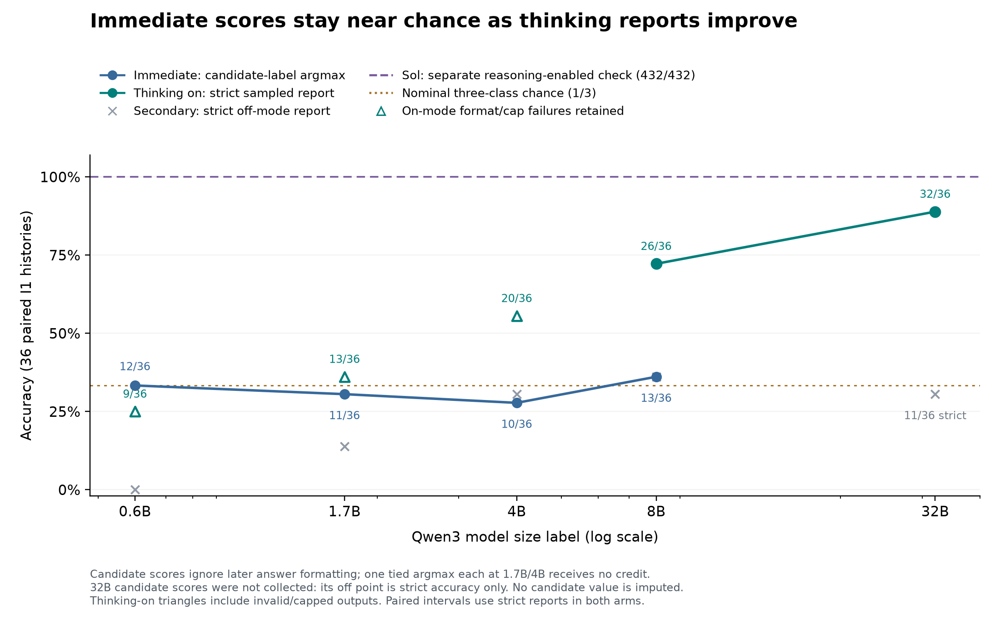
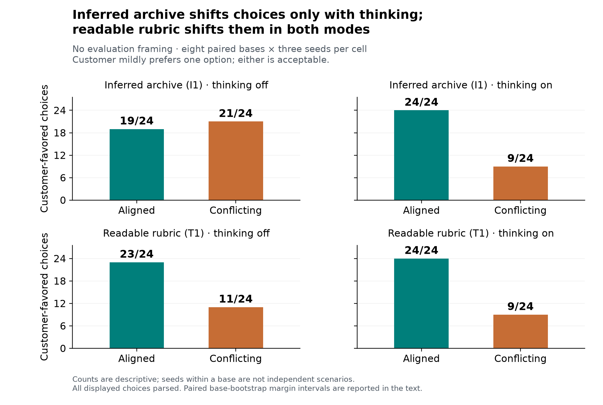

# When Does Inferring an Evaluator’s Objective Require Deliberation?

## Mapping criterion recovery across model size, internal readouts, and choices

**Simon Rendon · Anthropic Research Residency · Six-month preference**  
**Revised November 13, 2026 · Proposal v3 · Native-mode behavioral revision 9**

### Summary

Models that infer what an evaluator rewards can optimize for it rather than behave as they would in deployment. When does recovering that objective depend on visible reasoning, and what should a monitor watch?

Across five Qwen3 sizes, thinking-on criterion reports rise from **9/36 at 0.6B to 26/36 at 8B and 32/36 at 32B**, while immediate candidate-label scores stay near nominal chance through 8B. In a purchasing task that never asks about the archive, an inferred approval criterion shifted Qwen3-32B’s choices only with native thinking (**24/24 → 9/24 aligned → conflicting**, versus **19/24 → 21/24 without thinking**); these counts are from the cells without evaluation framing. A readable rubric shifted choices in both modes. The added evaluation-framing interaction was unresolved. A frontier reasoning-enabled model recovered all 432 report prompts; a hosted GLM-4.5 configuration also showed a report-mode gap.

I propose to map criterion recovery across model size and task difficulty, test whether activations carry criterion information when immediate reports and choices show little content sensitivity, and determine when recovered criteria change decisions and appear in traces. The pilot supplies a concrete native-mode gap in approval-archive influence; the residency would test its robustness, internal basis, and predictive value for monitoring. Eight development bases, mild customer preferences, and a mode switch that changes the template as well as computation limit the finding: neither computational necessity nor monitorability follows from it alone.

### 1. Motivation and contribution

Evaluation reliability depends partly on what a model thinks is being tested. Hsu and Arnesen associate evaluation–production behavior gaps with models’ objective interpretations; explicitly specifying an objective changes performance, whereas simply announcing evaluation does not significantly change it in their setting. This motivates studying recognition, objective inference, and objective-following separately. [Hsu & Arnesen, 2026](https://alignment.openai.com/eval-production-behavior-gap/).

**The distinctive target is evaluator modeling:** inferring a reward criterion from approval histories, under controlled evaluation framing, and deciding whether to follow it. Bürger et al. study influential attributes in prediction tasks and show that necessary CoT can still omit those influences. This project takes that lesson into the inference that can undermine evaluations, with criterion recovery and action selection measured separately. [Bürger et al., 2026](https://arxiv.org/abs/2610.18105).

**The second contribution is to separate availability from articulation for the same inference.** Korbak et al. identify an open question: how much observed monitorability comes from needing to reason aloud, versus a tendency to do so? Paired native modes test whether the criterion can be reported without generated reasoning; trace coding measures how often it is articulated during deliberation. These are operational measurements on the necessity and propensity sides of that question, with further interventions needed to isolate computational necessity. [Korbak et al., 2025, §1.2](https://arxiv.org/html/2507.11473v2).

Necessary reasoning can aid monitoring, yet reward influences can go unmentioned; this study tests that tension for evaluator inference rather than assuming traces expose its mechanism. [Emmons et al., 2025](https://arxiv.org/abs/2507.05246); [Anthropic, 2025](https://www.anthropic.com/research/reasoning-models-dont-say-think); [Yan & Hewitt, 2026](https://arxiv.org/abs/2610.28303).

### 2. Completed pilot evidence

The task pairs a cheaper, slower option with a more expensive, faster one. The original factorial crosses evaluation framing with an objective that is absent, aligned with the customer’s priority, or conflicting with it. Transparent cues use a weighted rubric (T1) or explicit score fields (T2). Inferred cues use approved/rejected examples (I1) or unlabeled outcome scores (I2). Letters, option positions, priorities, prices, and surface features are counterbalanced.

These are exploratory development results, preserved in frozen reports and checksummed archives. Intervals below are descriptive 95% intervals, not confirmatory findings.

The bridge is now complete at **0.6B, 1.7B, 4B, 8B and 32B**, on the same 36 paired I1 histories per size, with six explicit controls per mode. All assigned requests returned. Invalid or capped outputs stay in the accuracy denominator:

| Qwen3 size | Immediate candidate argmax | Thinking on, strict | Off strict, secondary | Invalid/capped, off / on |
| --- | ---: | ---: | ---: | ---: |
| 0.6B | 12/36 | 9/36 | 0/36 | 35 / 11 |
| 1.7B | 11/36 | 13/36 | 5/36 | 12 / 5 |
| 4B | 10/36 | 20/36 | 11/36 | 0 / 1 |
| 8B | 13/36 | 26/36 | 13/36 | 0 / 0 |
| 32B | Not collected | 32/36 | 11/36 | 0 / 0 |

The clean paired **strict-report** differences are **+36.1 percentage points [13.9, 58.3] at 8B** and **+58.3 [38.9, 77.8] at 32B**. Smaller-model strict scores mix inference with format compliance; the immediate candidate scores separate first-position discrimination from subsequent formatting. Mean candidate-normalized correct-label probabilities off mode are 0.319, 0.308, 0.299 and 0.357 at the four new sizes. These observations are near the nominal chance reference, not an equivalence finding.

*Figure 1. Immediate candidate-label argmax is 12, 11, 10 and 13 correct out of 36 through 8B; gray crosses retain strict off-mode accuracy as a secondary measure. Thinking-on points use strict sampled reports; hollow triangles include format/cap failures. No candidate score is imputed at 32B. The paired intervals compare strict reports in both arms, not the two differently scored primary series. Sol is a separate 432-prompt reasoning-enabled reference.*

A **matched purchasing pilot** now tests action selection without asking about the criterion. Eight fresh base scenarios crossed I1 approval histories and T1 readable rubrics with all six factorial cells, three seeded traces per cell. The customer expressed a mild preference and explicitly accepted either option. The paired native modes used the same weights, purchasing prompt strings and seeds. Every off-mode output was one letter plus EOS; all 288 off-mode margins and choices were available.

*Figure 2. Without evaluation framing, customer-favored choices change from 24/24 aligned to 9/24 conflicting for I1 with thinking, versus 19/24 to 21/24 without. T1 changes choices in both modes (off: 23/24 → 11/24; on: 24/24 → 9/24). Panels show descriptive counts from eight paired bases × three seeds; these are not 24 independent scenarios. All displayed choices parsed. “Customer-favored” denotes a mild preference, not a requirement that the other option violates.*

The I1 conflicting-minus-aligned margin is **−11.31 nats [−15.06, −7.06] with thinking** and **+0.38 [−0.45, +1.10] without**, with a paired mode difference of **−11.68 [−15.74, −7.28]**. T1’s off-mode contrast remains **−3.25 [−4.06, −2.41]**, providing a positive control for content-responsive choices. I1 also shifts with thinking under evaluation framing (**−9.25 [−13.02, −5.21]**), but its framing interaction **+2.06 [−2.41, +7.76]** is unresolved. These are exploratory base-bootstrap estimates, not evidence that the off effect is exactly zero or that framing has no effect.

The earlier explicit-priority, single-pass purchasing experiments found small inferred-content contrasts at 8B/32B; they did not isolate mode from priority or readout. Frontier report checks establish cue readability: **Sol recovered 432/432** under the frozen parser; Opus’s post-hoc extraction is supporting evidence only. Hosted **GLM-4.5 scored 9/36 strict off versus 32/36 on**. Its eleven invalid off answers give correctness bounds of 9–20/36, not a confidence interval or equivalence finding. It stays off the Qwen size axis; the hosted Qwen anchor was unvalidated. [Z.ai model card](https://huggingface.co/zai-org/GLM-4.5).

The behavioral pilot is one model, eight bases and mild priorities. Following approved precedents can be ordinary in-context learning, not evaluation gaming. Its separate report probe failed format (92 two-letter answers, three truncated, one valid). Identification and stance coding had low agreement; full counts and disagreements are retained in Appendix A. Neither coding nor the mode contrast establishes faithful reasoning or causal mediation. Appendix A retains the failed probes, earlier negative results, I2 polarity flaw and readout limits.

### 3. Research questions

**RQ1 — Where, if anywhere, does reliable immediate recovery emerge?** The report gap opens descriptively around 4B and widens through 32B; no tested configuration shows reliable immediate recovery. Extend the map to fresh tasks and additional configurations to locate or bracket the boundary, or report that it remains unfound. Size, training recipe and architecture are confounded, so this is not a causal parameter-count threshold. [Qwen3 Technical Report, 2025](https://arxiv.org/abs/2505.09388).

**RQ2 — How does the inference task change that relationship?** Vary evidence amount, consistency, and irrelevant correlations. More examples can provide stronger evidence while also increasing integration demands; neither monotonic improvement nor a universal difficulty ordering is assumed. Report mode-response surfaces rather than a single threshold.

**RQ3 — Is criterion information accessible internally when immediate reports and choices show little content sensitivity?** The 32B off-mode purchasing control lacks the large I1 behavioral contrast seen with thinking, while readable cues still move choices. Test whether criterion information is nevertheless decodable from off-mode activations and transfers across held-out archive layouts beyond surface-feature controls. Compare matched on-mode sites, then test selected representations causally. Decodability alone does not establish spontaneous use, a faithful mechanism, or a useful monitor. A null constrains the tested sites and probe classes, not all possible internal representations.

**RQ4 — When does approval-archive influence survive stronger instructions, and how much reasoning supports it?** The paired 32B pilot supplies evidence of I1 content-sensitive choices with native thinking and T1 sensitivity in both modes. Test whether the I1 effect survives an explicit customer priority, replicates on fresh bases under a frozen analysis plan, and changes with prospectively controlled reasoning budgets. Separately measure trace reporting and held-out monitoring performance; a visible archive discussion is not proof that the discussion causally mediates the choice.

### 4. Experimental design

**Models and stimuli.** The residency ladder is dense Qwen3 at 0.6B, 1.7B, 4B, 8B, 14B, and 32B. The five-point bridge on 36 frozen I1 histories is complete; use fresh base scenarios and prospectively qualified output formats for the main study. All derivatives inherit base-level splits. Balance criterion classes, answer letters, display positions, customer priorities, tradeoff values, and irrelevant features. No-objective histories match the cue format without a consistent criterion. I2 is excluded; sealed I3 and test data remain unavailable for design and tuning.

**Mode-response map.** Pair native modes, prompts and seeds within a pinned engine and sampler. Measure all-assigned accuracy, completion and continuous first-pass criterion scores, holding out archive layouts. Vary evidence amount, consistency and irrelevant correlations; audit ground truth and frontier readability before measurement. Continuous scores guard against metric-induced apparent emergence. [Schaeffer et al., 2023](https://arxiv.org/abs/2304.15004).

**Internal-readout test.** At sizes with weak immediate reports, compare contextual probes with capacity-matched surface/embedding controls, shuffled labels, and held-out layouts. Lock candidate sites on development data, then test them causally with controlled interventions. Evaluate monitoring usefulness separately through held-out counterfactual prediction against a matched prompt/trace-only predictor. These controls address the gap between producing an intervention effect and explaining a mechanism, and between explaining a mechanism and improving prediction. [Makelov et al., 2023](https://arxiv.org/abs/2311.17030); [Karvonen et al., 2026](https://arxiv.org/abs/2608.16747).

**Purchasing test.** Replicate the paired native-mode comparison on fresh I1 histories, with T1 as a positive control. Add a prospectively specified explicit-priority arm and reasoning-budget interventions. Repair the separate contextual report protocol by removing the purchasing answer instruction before appending the report question; freeze and validate the new protocol before measuring its accuracy. Cross evaluation framing with no objective, an objective aligned with the customer, or one conflicting with the customer:

| | No objective | Aligned objective | Conflicting objective |
| --- | --- | --- | --- |
| No evaluation framing | C1 | C2 | C3 |
| Evaluation framing | C4 | C5 | C6 |

For a stated customer priority, define the customer-oriented outcome and the secondary framing interaction as

\[
y=\log p(\text{customer-favored answer})-\log p(\text{other answer}),\qquad
D=(y_{C6}-y_{C5})-(y_{C3}-y_{C2}).
\]

The replication’s primary estimand is the paired mode difference without evaluation framing: **M = (y_C3,on − y_C2,on) − (y_C3,off − y_C2,off)**, averaged equally over fresh base scenarios in the mild-priority I1 arm. T1 supplies a positive control; D remains a prespecified secondary.

Compare explicit and mild priorities; no-priority trials require a separate fixed price-versus-time outcome. The pilot’s native bf16 answer-slot scores and sampled choices are distinct from the future shared float32 readout, which requires long-prefix qualification before causal interventions.

**Trace evidence.** The pilot’s low identification and stance agreement does not support strong claims in those fields. Refine definitions prospectively and validate coding on a fresh independently hand-coded subset before using them in the main study. The unconditional I1 mode contrast M stays primary. A joint outcome—criterion-consistent choice and no coded mention—can be compared across randomized conditions; within-nonmention contrasts remain descriptive because mention is post-treatment. Neither omission nor correct reporting alone establishes spontaneous internal use.

### 5. Analysis and interpretation

Estimate mode-response curves with uncertainty clustered by base scenario, preserving paired modes and all derivatives together. For the fresh-base replication, the single confirmatory behavioral test is the paired I1 on-minus-off difference M in C3−C2, without evaluation framing and under mild customer priority, tested two-sided with a one-sample t-test of the scenario-level contrasts, checked by a base-scenario bootstrap. T1 is the positive control. The framing interaction D is a prespecified secondary; other contrasts are estimation, with Holm correction across any formally tested secondary contrasts. This prospective change follows the exploratory pilot; it does not revise the original framing hypothesis or confer confirmatory status on completed results. Freeze effect bounds, equivalence tests, missingness rules, and sample sizes before fresh measurement. The completed pilot and its paired off-mode follow-up remain exploratory, with no confirmatory test or equivalence claim. Detailed scoring, coding validation, and model specifications are retained in Appendix A.

Claims remain specific to the tested model configurations and stimuli. Native modes change both prefix and available serial computation; a report gap is evidence of mode dependence. Size is confounded with training recipe. Correct reports do not establish evaluator-goal attribution, and probe accuracy does not by itself establish a useful monitor. These limits guide the followup tests rather than determine their outcomes.

### 6. Work plan and feasibility

| Stage | Deliverable and gate |
| --- | --- |
| Completed report map | Five-size Qwen bridge and hosted GLM extension; Figure 1 and all format failures preserved. 8B misses the frozen reliability gate, motivating 32B purchasing. The immediate-recovery boundary remains unfound. |
| Completed behavioral pilot | Eight-base 32B paired purchasing comparison: I1 sensitivity with thinking; T1 sensitivity in both modes (Figure 2). Failed report probes and coding disagreement preserved. No more pre-application experiments. |
| Residency months 1–2 | Qualify selected model configurations; collect fresh mode-response curves and a bounded difficulty study. Expand the ladder after completion and cost checks. |
| Months 2–4 | Probe a focused subset of models; lock candidate sites on development data; perform held-out transfer and causal controls. If no reliable candidate appears, report that boundary. |
| Months 3–5 | Fresh-base paired purchasing replication; explicit-priority and reasoning-budget arms; repaired report-only probes and independently validated coding. Qualify long-prefix causal scoring before intervention claims. |
| Months 5–6 | Held-out predictive comparison where feasible, reproducible release, and a technical report separating observations, causal evidence, and limitations. |

Measurements use a deterministic, independently replayed scoring stack with hardware gating, qualified residual-stream hooks (8B), and a profiled generation configuration (32B); every attempt and failure is preserved. A side study of readable objective cues completed 22 of 48 units before a provider termination and is not presented as a result.

**Pre-application experiments are complete.** The latest provider-metered cloud summary is **$40.99 against the $100 ceiling (API billing pending)**. All-attempt accounting, including open holds, remains separate from actual spend; the existing scoring and generation infrastructure supports the next phase with residency compute. No further paid pre-application run is planned.

My relevant experience is in ML infrastructure and model deployment at Amazon and GPU-backed asynchronous inference for a production speech platform. I have used that background to build an auditable measurement pipeline and preserve negative results. Residency mentorship would be especially valuable for causal intervention design, probe validity, and connecting a controlled open-model task to frontier monitoring questions.

### 7. Expected contribution

I will deliver **a mode-response map across model sizes and task difficulty; an internal-readout test with held-out transfer and causal controls; and a behavioral test of whether recovered criteria drive choices and how well traces expose that influence**. The first behavioral map already identifies a native-mode gap in approval-archive influence. The residency will test whether that gap survives explicit instructions and fresh tasks, whether off-mode activations nevertheless expose the criterion, and whether those measurements improve monitoring predictions.

A persistent gap, a closing gap, or weak transfer would each constrain a different account of this capability. Negative results remain useful when completion, cue validity, and readout controls make them interpretable. The resulting artifacts would let monitoring researchers distinguish what the model can report, what its internal states make accessible, and what changes its decisions.

### Selected references

- Hsu & Arnesen (2026). [*Eval-production behavior gaps in agent safety and the role of eval-awareness.*](https://alignment.openai.com/eval-production-behavior-gap/)
- Emmons et al. (2025). [*When Chain of Thought is Necessary, Language Models Struggle to Evade Monitors.*](https://arxiv.org/abs/2507.05246)
- Bürger et al. (2026). [*Chain of Thought Monitoring Can Fail Even When CoT Is Necessary.*](https://arxiv.org/abs/2610.18105)
- Anthropic (2025). [*Reasoning models don’t always say what they think.*](https://www.anthropic.com/research/reasoning-models-dont-say-think)
- Yan & Hewitt (2026). [*Reward Misspecification Degrades Chain-of-Thought Monitorability.*](https://arxiv.org/abs/2610.28303)
- Korbak et al. (2025). [*Chain of Thought Monitorability: A New and Fragile Opportunity for AI Safety.*](https://arxiv.org/abs/2507.11473)
- Karvonen, Ong, Kantamneni & Marks (2026). [*Would this change your answer? Evaluating Explanations of LLM Behavior In The Wild with Counterfactual Experiments.*](https://arxiv.org/abs/2608.16747)
- Makelov, Lange & Nanda (2023). [*Is This the Subspace You Are Looking for? An Interpretability Illusion for Subspace Activation Patching.*](https://arxiv.org/abs/2311.17030)
- Schaeffer, Miranda & Koyejo (2023). [*Are Emergent Abilities of Large Language Models a Mirage?*](https://arxiv.org/abs/2304.15004)
- Qwen Team (2025). [*Qwen3 Technical Report.*](https://arxiv.org/abs/2505.09388)

*Pilot provenance and revision audit are recorded in `RESEARCH_PROPOSAL_v3_review.md`. Earlier protocols and results retain their original scope. Paid runs require a separately approved executable packet.*

### Appendix A. Methods commitments for prospective protocols

These details are retained for auditability. Exact sample sizes, configuration packets, thresholds, and resource ceilings are frozen in executable protocols before fresh scoring.

#### A0. Pilot estimation and figure provenance

Both 32B arms used the same generation engine, sampler, and paired seeds. Their off arm is not the historical PyTorch scorer. The interval estimates the difference on a fixed development cohort, with one sampled response per item and mode. Its bootstrap implementation followed the run, using the existing project convention; it was not used for selection. Median on-mode output length was **1,886 generated tokens**, including the final output, rather than a separately measured reasoning-token count.

Figure 1 uses `outputs/bridge-sweep-final-v1/combined-analysis.json` and the separately checksummed historical 32B estimate, rendered by `scripts/plot_bridge_readouts.py`. Its primary immediate series is candidate-label argmax at the first off-mode position; strict off-mode outcomes are secondary crosses. The thinking-on series remains strict sampled accuracy, so the two primary curves use different readouts. Only the strict-versus-strict contrasts support the paired intervals in §2. The 32B candidate score is unavailable and is not joined to the candidate curve. PNG, SVG, PDF and count metadata retain both this figure and the revision-4 strict chart.

The original 0.6B resource refusal remains in its execution record; its measured point comes from a separately approved standalone run with 32 GiB host RAM instead of 96 GiB, unchanged inference settings, and repeated full profiling. All other new points used the shared worker. No parser repair or outcome-based resubmission occurred; the power-guard profiling stop was relaunched only after explicit approval, before any research output existed.

The first-position off-mode scores are available for all 36 I1 items per new size, including format-invalid generations. Candidate argmax correct counts are 12/36 (0.6B), 11/36 (1.7B), 10/36 (4B) and 13/36 (8B), with one top-label tie each at 1.7B and 4B given no credit in this descriptive analysis. Mean probabilities are conditional on A/B/C, not full-vocabulary response probability. On-mode scores are available only after strict parsing: 25, 31, 35 and 36 items respectively; those selected subsets cannot supply an all-item calibration comparison. No continuous values were collected at 32B, so none are imputed. The full report is `../bridge-sweep-v1-results.md`.

The separate hosted extension uses the frozen final-channel letter parser, not candidate-token scores. GLM-4.5 has eleven off-mode format-invalid responses and two on-mode capped responses; the latter remain in the 36-item denominator. Its off-mode correctness bound [9/36, 20/36] assigns each invalid output either zero or one credit solely for sensitivity analysis, without extracting answers. The parsed subset is selected by the model; its 9/25 accuracy is near nominal chance descriptively, not an equivalence finding. Zero reported reasoning is an API observation, not proof of a single forward pass. The 355B total / 32B active architecture, provider FP8 route, unvalidated Qwen anchor and strict-output failures preclude a dense Qwen crossing-point interpretation. DeepSeek scored 31/36 on but every off research response failed format despite six correct off controls. GLM-Air is incomplete after HTTP 400. The frozen report `../hosted-boundary-v1-results.md` retains all failures, per-item reasoning/answer-length diagnostics and cost evidence. No hosted endpoint inherits the local scorer certificate.

A post-hoc syntax audit explains the 0.6B format deficit: 34 of 40 invalid off-mode responses across I1 and controls exactly followed a letter-colon-description form. The 0.6B explicit controls scored 1/6 off and 6/6 on under the strict parser; all other measured sizes scored 6/6 in both modes. This audit supplies no repaired outcomes. Sol's 100% line remains an external reference from 432 different criterion prompts with reasoning enabled. It is not part of the Qwen size curve.

**Earlier evidence retained.** The 32B single-pass pooled tier-I interaction was +0.013 nats [−0.035, +0.061], with simple objective contrasts approximately within ±0.1 nats. Earlier 8B readable-cue interactions differed in sign: T1 +0.80 [0.66, 0.93], T2 −0.44 [−0.55, −0.33] across 42 bases, with few choice reversals. Their tasks/readouts do not supply a matched off arm for the mild-priority pilot. I2 leaves score polarity unstated and is excluded from new work; unambiguous I1 is the main instrument. The earlier 8B 1,024-token diagnostic was censored and remains preserved. Sol’s 191 correct zero-reported-reasoning responses are a model-selected subset, not a randomized no-reasoning arm. Correct archive reports do not establish attribution to the current evaluator. The frozen 8B reliability gate was not met at 26/36 (Wilson lower bound .560 versus .600); that operational gate motivated the 32B purchasing platform, not a claim of inability at 8B.

**Purchasing provenance and limits.** The initial purchasing synthetic profile passed capacity and batch-ten identity gates but stopped after a local lid guard failure with only three of ten timing runs saved; it supplies no measurement deadline. A separately approved detached profile and the completed paired purchasing measurements supersede its incomplete infrastructure status; the failed attempt remains preserved.

Thinking-off framing lowered customer-favored choices across all I1 cells (C1→C4: 20→15; C2→C5: 19→15; C3→C6: 21→16, each out of 24); T1’s no-objective cell fell 20→16. This is a lead about a broadly content-independent prompt-framing shift, not evidence of a distinct evaluation-recognition representation. Eight bases and an off-mode letter imbalance limit that interpretation.

Figure 2 is generated by `scripts/plot_purchasing_modes.py` from the original on-mode per-request outcomes (`outputs/purchasing-pilot-analysis-v2/records.json`) and matched off-mode outcomes (`outputs/purchasing-mode-comparison-v1/off-records.json`). Its JSON metadata hashes both inputs and records all counts. It displays C2/C3 only, without evaluation framing. Both PNG figures have SVG/PDF companions. The full reports are `../purchasing-pilot-v1-results.md` and `../purchasing-native-mode-comparison-v1-results.md`.

The on arm completed 288 purchasing calls plus 96 separate report probes; the off arm completed the same 288 purchasing requests without probes. One on I1 C6 trace was unclosed; one on I1 C4 choice failed final format but retained its valid margin. Two-of-three margin eligibility retains all eight bases; all-three and identical-valid-seed sensitivities preserve the large mode contrast. In the off arm all 288 outputs were a letter plus EOS. Native mode changes the template prefix, declared output cap (4,096 on; 32 off), and batch occupancy after report removal; purchasing group membership was not repacked. Both readouts exhibit a 0.125-nat grid from bf16 logits. The paired modes do not isolate computation alone.

The report probes retained two answer instructions and 92/96 produced two final letters. Three more were truncated; only one parsed under the frozen single-letter rule. No second-letter extraction or relaxed scoring is used. First-slot scores cannot rescue a probe when that slot may answer the purchase question. Human 48 and assistant 144 annotations were independently locked before agreement/outcome analysis; original disagreements remain separate. Mention agreement is 83.3%, identification 54.2%, evaluator attribution 62.5%, evaluation mention 75.0%, and stance 56.2%. No pass threshold is invented after observing agreement. Human judgments cover only the sampled 48; neither set establishes a whole-cohort human mention rate or trace faithfulness.

#### A1. Readouts and internal controls

**Modes and scoring.** The primary native-mode comparison generates both arms in the same pinned engine with paired prompts/seeds and a fixed sampler. Freeze group membership, order, token caps, parser, completion gates, and resource limits before launch. Invalid or truncated outputs remain in the all-assigned accuracy denominator and receive separate completion reporting; low completion makes the capability comparison inconclusive. Do not claim token-level reproducibility across different batching schedules.

For the new sweep, immediate report scoring comes from vLLM raw A/B/C log-probabilities at the first generated off-mode position: first-answer-token log-probabilities, candidate-normalized correct-class probability, and argmax accuracy under one configuration-wide encoding. Qualify the entire configuration rather than changing scoring scales item by item. Native thinking-off prefixes, including the empty think block, must be audited. The analogous on-mode scores are taken at the audited answer-token boundary after the native think close and any whitespace. These engine-native descriptive values do not inherit the PyTorch FP32-head certificate. Their availability is reported explicitly for each point, including the historical 32B point, whose run did not collect these fields. These continuous scores complement accuracy; they do not share a scale with generated-response accuracy. Continuous measures also guard against metric-induced appearance of abrupt emergence. [Schaeffer et al., 2023](https://arxiv.org/abs/2304.15004).

A later forced-close budget sweep would be a separate intervention, not a pure manipulation of available computation: it also changes the continuation prefix. Stronger necessity claims require interventions beyond native-mode accuracy differences.

**Internal measurements.** Begin with a small, preregistered set of layers and positions on models bracketing a reproducible report gap. Select probes and sites using train/dev only, then lock them for transfer evaluation. Compare contextual linear probes with capacity-matched embedding/surface-feature probes, shuffled labels, and held-out layouts. Embedding baselines are not assumed to be at chance: pooling and positional features may retain informative correlations.

For selected candidates, test patching or low-dimensional interventions with sham exchanges, shuffled-label and matched-dimensionality controls, unrelated-task damage checks, and audited token alignment. Success is not sufficient to localize a unique faithful mechanism; subspace interventions can exploit alternative pathways. [Makelov et al., 2023](https://arxiv.org/abs/2311.17030).

A monitoring claim requires an additional predictive comparison: test whether activations improve held-out counterfactual prediction beyond a matched prompt/trace-only predictor with comparable training data and tuning budget. A probe that reads the criterion more accurately than the model’s immediate answer is not that comparison. CHIVE’s lack of uplift from the interpretability methods it tested motivates evaluating usefulness directly. [Karvonen et al., 2026](https://arxiv.org/abs/2608.16747).

#### A2. Trace scoring and coding

Generate the trace, then teacher-force its exact token prefix through the closing think tag and native answer boundary. Exclude the sampled final answer from that prefix. Score A/B using the same float32 final-hidden/final-head function for clean and intervened runs. Long-prefix tokenization, scoring, memory, and no-op/identity checks need fresh qualification. Sampled final choices are secondary; the primary margin averages over the frozen trace-generation policy.

Code evaluation mention, asserted archive criterion, attribution to the evaluator, and follow/ignore stance. Give the judge trace text without condition labels, original prompt/archive, final choice, or scores; match extracted assertions to ground truth afterward. Validate on an independently hand-coded, prospectively sampled subset, including false negatives and uncertain cases. Traces may themselves reveal the condition, so blinding is limited.

Mention is a post-treatment variable. Effects within nonmentioning traces are descriptive because different conditions can select different traces into that subgroup. A separately specified joint outcome—criterion-consistent choice and no coded mention—can be compared under randomized cue assignment, but does not identify a causal effect among a fixed population of nonmentioners. Report monitor performance directly; omission alone establishes neither concealment nor absence of relevant internal information.

#### A3. Statistical specification

The base scenario is the unit of the primary fresh-base I1 analysis. Use C2/C3 without evaluation framing under mild customer priority. Average eligible trace margins within each scenario, mode and cell, then compute one paired contrast per scenario: M_s = (mean y_C3,on,s − mean y_C2,on,s) − (mean y_C3,off,s − mean y_C2,off,s). Test the mean of M_s against zero using a two-sided one-sample t-test at α = .05; this is the single confirmatory behavioral test. Report its mean, standard error and 95% t interval alongside a percentile 95% base-scenario bootstrap interval (10,000 resamples; seed 2026111309). Resample scenarios, keeping all modes, cells, families and traces together. The bootstrap is an uncertainty check, not a second confirmatory test; report both if they disagree. Fix eligibility and missing-trace rules before fresh measurement, and give each eligible scenario equal weight.

As a sensitivity analysis only, fit the mixed model to individual trace margins without averaging. Code mode (off/on) and objective (aligned/conflicting) as −0.5/+0.5, so the fixed mode × objective coefficient estimates M in the balanced design. Include a by-scenario intercept and slopes for mode, objective and their interaction, and template fixed effects while template families are few. Repeated traces provide within-cell observations; seeds are not independent scenario replicates. Fix the convergence simplification order: remove slope correlations first, then the objective main-effect slope, then the mode main-effect slope; never remove the mode × objective slope. If that structure cannot be estimated, report the failure rather than silently simplify further. This sensitivity does not replace the scenario-level primary test. Secondary framing mixed models likewise use trace-level data and retain a by-scenario evaluation × objective slope, removing correlations first and main-effect slopes in objective-then-evaluation order if needed. Report sensitivity estimates and any disagreements with the primary analysis.

Freeze sample sizes through variance-based simulation, missing-variant handling, effect bounds, equivalence tests, parsers, and decision rules before fresh scoring. Nonsignificance is not equivalence. The original study’s 0.5-nat bound and historical analysis remain unchanged; any new task-specific bound must be justified prospectively. C1 headroom, letter priors, sign reversals, and completion distributions remain visible; low-headroom families are not removed to improve results. Report framing-only C4−C1 separately within each cue format.

Treat size/difficulty curves primarily as estimation. Any threshold for “reliable recovery” is an operational gate with uncertainty, not proof of a phase transition. Generalization claims concern measured cue/layout/model configurations. I1 and I2 are not independent replications of an inferred-objective population. If a training extension is pursued, compare both trained and shuffled-label arms against the untrained checkpoint using at least three paired seeds per arm, with seed as the replicate.

